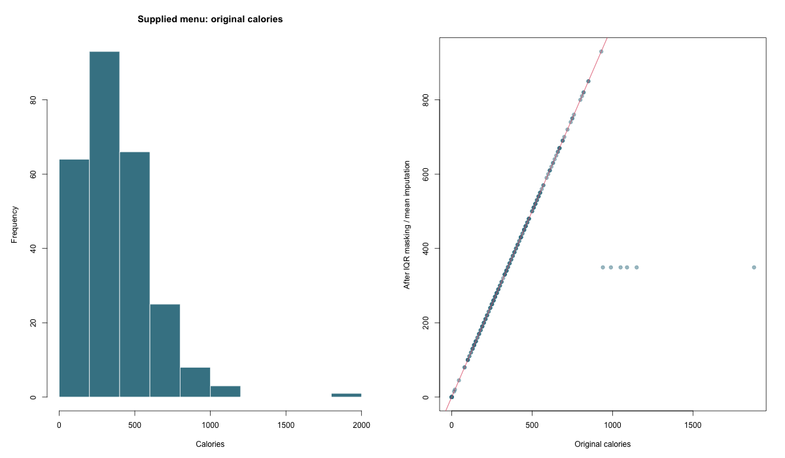

# Menu Nutrition Analysis

Nutrition exploration, correlated-feature grouping, and explicit outlier-treatment comparisons.

**Author and maintainer:** Abhinav Tanwar.

## Run

Requires R 4.4+; install `jsonlite`, `rpart`, `mclust`, `randomForest`, and `glmnet` as applicable.

```sh
Rscript scripts/run.R
Rscript tests/checks.R
```

## Methods and limitations

Uses the locally found original menu CSV. Numeric correlations are descriptive; percentage daily-value versions are grouped with their base nutrient when ranking correlations with calories. The source IQR masking and mean-imputation workflow is preserved as a sensitivity comparison, not as an assertion that calorie-dense foods are erroneous records. Original and modified summary statistics are both reported.

## Measured results


[Full calculated metrics](results/metrics.json) · [Input provenance](data/README.md) · [Method changes](docs/methodology.md). Open `report.html` for the visual summary.


